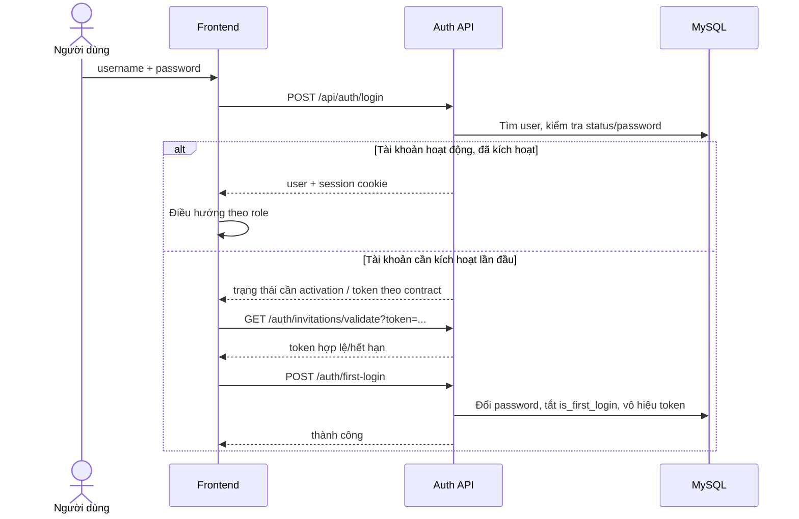
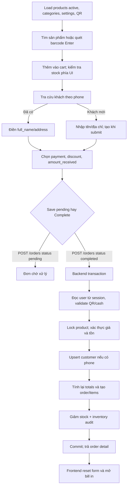
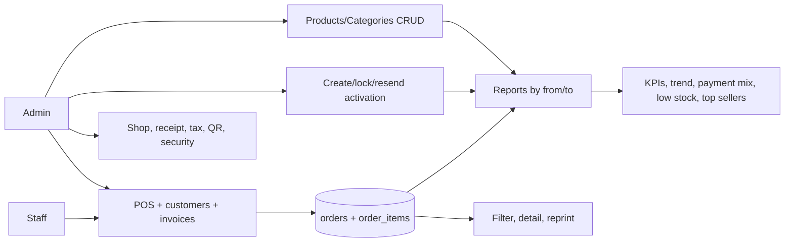

# Báo cáo bàn giao Frontend – Backend – Database

**Dự án:** B'TRIPLE POS – quản lý bán lẻ thời trang  
**Ngày rà soát:** 2026-05-16  
**Phạm vi:** Frontend hiện có, các lời gọi API được dùng trong mã nguồn, schema `fashion_pos_db` và mức sẵn sàng triển khai PHP thuần.

> Đây là báo cáo dựa trên mã nguồn hiện diện trong repository, không phải xác nhận rằng API PHP đã chạy. Backend API hiện chưa được triển khai. Chưa tìm thấy file PDF barem trong repository; các tiêu chí barem được đối chiếu là những yêu cầu đã nêu trong trao đổi. Những endpoint và JSON mẫu phía dưới là contract đề xuất để Backend triển khai tương thích Frontend.

## 1. Kết luận điều hành

Frontend đã có các màn hình và luồng chính cho đăng nhập/kích hoạt tài khoản, dashboard/báo cáo, POS, hóa đơn, sản phẩm/danh mục, khách hàng, nhân viên, hồ sơ và cài đặt. Các request dữ liệu được tập trung qua `PosApi` và đi tới `/api/`. POS, quản lý sản phẩm và báo cáo chỉ hiển thị dữ liệu do API cung cấp; khi API lỗi, giao diện hiển thị trạng thái lỗi thay vì dữ liệu mẫu.

Tuy nhiên, dự án **chưa sẵn sàng vận hành end-to-end với Database**:

1. `backend/config/database.php` mới là file stub; chưa có router API, middleware, controller, service, repository hay xử lý nghiệp vụ.
2. `database/database.sql` có một câu `ON DUPLICATE KEY UPDATE` đứng riêng sau `CREATE TABLE store_settings`; đây là cú pháp không hợp lệ nếu chạy trực tiếp như SQL hoàn chỉnh và cần sửa trước khi import.
3. Login đã được thử với `/api/auth/login` nhưng nhận HTTP 404. Đây là bằng chứng API chưa được phục vụ tại đường dẫn Frontend đang gọi, không chứng minh các phần Backend khác.
4. UI có điều hướng/ẩn trường theo role lưu trong `sessionStorage`. Đây chỉ là UX, không phải bảo mật. Backend phải xác thực session và phân quyền ở mọi endpoint.
5. POS gửi các giá trị tổng hợp hiển thị ở client trong `totals` cùng `amount_received` và `change_amount`. Backend phải tự xác định user, giá, tồn kho và tính lại mọi tổng tiền từ DB; không tin các giá trị do trình duyệt gửi.
6. Nút “Save Sale” tạo order `pending`, còn “Print & Complete Sale” tạo order `completed`. Chính sách giữ tồn kho, huỷ/tiếp tục đơn pending cần được quy định trước khi hoàn thiện nghiệp vụ.

## 2. Kiểm kê Frontend hiện tại

### 2.1. Cấu trúc đã có

| Khu vực | File tiêu biểu | Trách nhiệm |
|---|---|---|
| Entry/dashboard | `frontend/index.html` | Dashboard, lọc thời gian, KPI, biểu đồ, bảng đơn gần đây, cảnh báo kho, top nhân viên |
| API client/layout | `frontend/assets/js/api.js`, `frontend/assets/js/common.js` | Fetch JSON/FormData tới `/api/`, tải header/sidebar/footer, menu theo role, thông báo |
| Thành phần dùng chung | `frontend/components/header.html`, `sidebar.html`, `footer.html` | Khung giao diện và điều hướng tái sử dụng |
| Đăng nhập/kích hoạt | `frontend/pages/auth/login.html`, `login.js`, `first-login.html`, `first-login.js` | Login, xác thực token mời, đặt mật khẩu lần đầu, logout |
| POS | `frontend/pages/pos/index.html`, `pos.js`, `pos.css` | Tìm/barcode, chọn khách, giỏ, thanh toán, lưu pending, in bill |
| Hóa đơn | `frontend/pages/invoices/index.html` | Lọc danh sách, KPI hôm nay, chi tiết, in lại, export |
| Sản phẩm/danh mục | `frontend/pages/products/index.html`, `products.js` | CRUD, tồn kho, giá nhập chỉ hiển thị cho admin, ngăn xóa sản phẩm đã bán |
| Khách hàng | `frontend/pages/customers/index.html`, `customers.js` | CRUD và tìm kiếm |
| Nhân viên | `frontend/pages/users/index.html`, `users.js` | Danh sách, tạo nhân viên, khoá/mở khoá, gửi lại link |
| Báo cáo | `frontend/pages/reports/index.html`, `frontend/pages/reports/reports.js` | Báo cáo theo ngày, KPI, biểu đồ, bảng đơn và chi tiết |
| Cài đặt | `frontend/pages/settings/index.html`, `settings.js` | Thông tin shop, bill, VAT, QR, thời hạn link và đổi mật khẩu admin |
| Hồ sơ | `frontend/pages/profile/index.html`, `profile.js` | Tên, điện thoại, avatar, đổi mật khẩu |
| Giao diện | `frontend/assets/css/variables.css`, `base.css`, `custom.css`, `management.css`, `reporting.css` | Tokens và style dùng chung/quản lý/báo cáo |
| Database | `database/database.sql` | Schema MySQL cho user, product, order và các bảng mở rộng |

`frontend/assets/js/` hiện chỉ chứa API client và layout/auth guard dùng chung. `frontend/pages/reports/reports.js` sở hữu logic báo cáo và được nạp ở cả Dashboard lẫn trang Báo cáo vì hai màn hình dùng cùng bộ lọc/KPI. Các file cấu hình hiện có nên được giữ gọn; không đặt URL endpoint rải rác trong từng màn hình.

### 2.2. API client và response hiện được Frontend chấp nhận

`frontend/assets/js/api.js`:

- Dùng `fetch`, `credentials: "same-origin"` và `Accept: application/json`.
- JSON request tự đặt `Content-Type: application/json`; upload `FormData` để trình duyệt tự tạo multipart boundary.
- Chuyển lỗi HTTP, lỗi kết nối và JSON sai định dạng thành `ApiError`.
- Base URL cố định là `/api/`.

Các màn hình chấp nhận một số dạng danh sách để hỗ trợ tích hợp: mảng trực tiếp hoặc `{data: [...]}`, `{items: [...]}`, đôi khi `{data: {orders: [...]}}`. Để tránh response biến đổi khó bảo trì, Backend nên chuẩn hoá một envelope thống nhất; Frontend có thể được điều chỉnh một lần theo contract chính thức.

Response envelope khuyến nghị:

```json
{
  "data": {},
  "meta": {}
}
```

Lỗi:

```json
{
  "error": {
    "code": "VALIDATION_ERROR",
    "message": "Dữ liệu gửi lên không hợp lệ.",
    "details": {
      "phone": "Số điện thoại không hợp lệ."
    }
  }
}
```

HTTP status dùng nhất quán: `200` đọc/cập nhật, `201` tạo, `204` xoá thành công nếu không cần body, `400` request sai, `401` chưa xác thực, `403` không đủ quyền, `404` không tìm thấy, `409` xung đột tồn kho/unique, `422` validation nghiệp vụ, `500` lỗi nội bộ. Với lỗi, vẫn trả JSON và không trả stack trace/SQL.

### 2.3. Ma trận role phía giao diện

| Chức năng | Admin | Staff | Cashier |
|---|---:|---:|---:|
| Dashboard/báo cáo | Có, gồm lợi nhuận | Có, không xem lợi nhuận | Không theo route hiện tại |
| POS | Có | Có | Có |
| Hóa đơn | Có | Có | Không theo route hiện tại |
| Xem sản phẩm | Có, có giá nhập | Có, không được nhận/hiện giá nhập | Không theo route hiện tại |
| Danh mục | Có | Ẩn | Không |
| Khách hàng | Có | Có | Không theo route hiện tại |
| Nhân viên, cài đặt | Có | Ẩn | Không |
| Hồ sơ | Có | Có | Có |

Nguồn hiện tại là `roleRoutes` trong `frontend/assets/js/common.js`; dashboard ẩn profit card theo role trong `reporting.js`; bảng sản phẩm chỉ render `import_price` nếu role admin. Backend phải lặp lại chính sách này ở server: không gửi `import_price` hoặc profit cho role không được phép; không chỉ dựa vào CSS, `hidden`, hay `sessionStorage`.

## 3. Sơ đồ nghiệp vụ

### 3.1. Login và kích hoạt tài khoản



Khuyến nghị bảo mật: ưu tiên session cookie `HttpOnly; Secure; SameSite` thay vì trả bearer/session secret vào JavaScript. Trang hiện tại dựa vào dữ liệu `sessionStorage` để quyết định điều hướng; sau khi Backend có session, bổ sung `GET /auth/me` lúc khởi tạo layout để xác minh trạng thái thật. Token kích hoạt nên được hash khi lưu, dùng một lần, có hạn 60 giây theo cấu hình.

### 3.2. POS và ghi nhận đơn



Front-end không thể đảm bảo hết xung đột tồn kho khi có nhiều máy POS. Việc đọc/khóa số lượng và cập nhật kho phải nằm trong cùng transaction.

### 3.3. Quản lý và báo cáo



## 4. Gap analysis – mức sẵn sàng Backend

| Phân hệ | Frontend hiện có | Backend/API còn phải làm | Ràng buộc nghiệp vụ |
|---|---|---|---|
| Auth/login | Username/password; đọc role, `is_first_login`; điều hướng | Login, logout, me, invitation validation, first login, password update, session | Password hash; account status; expiry/use-once token; role chỉ lấy từ DB |
| POS/product search | Tải product active và category; filter cục bộ; barcode exact match Enter | Product list; category list; customer lookup; QR/settings | Trả barcode, price, stock, size/color; không nhận stock UI là sự thật |
| POS/customer | SĐT lookup; khách mới nhập tên/địa chỉ; gửi nested customer và có thể `customer_id` | Lookup theo phone, transaction tạo/cập nhật khách nếu có phone | Phone unique; xử lý race khi hai quầy tạo cùng số; cho phép khách lẻ khi không có phone |
| POS/cart | Add/remove/increment/decrement; chặn vượt stock theo dữ liệu tải trước | `POST /orders`; endpoint pending/complete/cancel/resume nếu hỗ trợ tiếp tục | Server tính lại giá/tổng/thuế/discount/change; chống double-submit; transaction |
| Thanh toán | `cash`, `card`, `qr_code`; amount received/change; xác nhận QR ở UI | Ghi payment method; trả trạng thái; quản lý QR active; nếu QR online cần đối soát thật | Click “đã xác nhận QR” trên UI không phải bằng chứng thanh toán từ cổng thanh toán |
| Hóa đơn | Lọc ngày, search, payment method; xem detail; in; export CSV | List/detail order với customer, cashier, items/product snapshot | Phân trang; filter theo timezone; chỉ hiển thị đơn được phép; không hard-delete order |
| Sản phẩm | CRUD admin; filter/search; cột import price ẩn staff; ngăn xóa nếu đã bán | Product CRUD/search; kiểm tra `has_orders`/`order_count`; role checks | FK order item RESTRICT; sản phẩm đã bán chuyển inactive thay vì xóa |
| Danh mục | CRUD trong màn hình products; route hash `#categories` | Category list/CRUD | Chỉ admin; không xóa category đang được sản phẩm tham chiếu nếu chưa xử lý |
| Khách hàng | CRUD và lookup | List/create/update/delete hoặc deactivate; lookup | Không xóa cứng khách gắn hóa đơn; cân nhắc inactive/anonymize |
| Nhân viên | Thêm; lock/unlock; resend link; gắn `data-user-id` | User list/create/status/resend; sinh link và gửi email | Modal chỉ nhập họ tên + Gmail; Backend sinh username/mật khẩu/token; không cho tự khóa admin cuối cùng |
| Báo cáo/dashboard | Gửi `from`, `to`; hiển thị revenue/orders/items/profit/trend/orders; HTML có chart/payment/stock/top sellers | Sales aggregate, detail order, low-stock, payment mix, top sellers | `completed` mới tính doanh thu; profit admin-only; quy tắc ngày/ca rõ ràng |
| Settings | GET/PUT store_settings; QR list/upload/toggle; change admin password | Settings read/write; QR upload, activate/deactivate; auth password | Validate allowlist keys, file MIME/size, random server filename, không nhận path tùy ý |
| Profile | `auth/me`; PUT thông tin; upload avatar; đổi password | Me/profile read/update/upload/password | Chỉ cập nhật user hiện tại; validate ảnh, giới hạn size; không cho sửa role/status qua profile |
| Shift/messages | Có bảng DB nhưng không thấy màn hình/API Frontend tương ứng trong scope kiểm kê | Chưa thuộc contract Frontend hiện tại | Có thể để phase sau, không nên xây endpoint chỉ vì bảng đã tồn tại |

### Các thiếu sót cần chốt trước khi tích hợp

1. **API base path/server:** Frontend gọi `/api/` từ origin hiện tại. Cần cấu hình Apache/Nginx/PHP để route đúng, CORS chỉ cần nếu Frontend và API khác origin.
2. **Session thật:** Frontend đang đọc role/id/name từ sessionStorage và gửi `user_id`; cần Backend xác thực cookie session. Có thể giữ cache UI nhưng không coi đó là danh tính tin cậy.
3. **Pending order:** POS gửi `status: "pending"` cho Save Sale, nhưng chưa có luồng list/resume/cancel pending rõ ràng. Chốt có giữ hàng hay không, ai được hoàn tất/hủy, thời gian hết hạn, và khi nào trừ tồn.
4. **QR:** POS kiểm tra có QR active, hiển thị modal và cho người bán bấm xác nhận. Đây là xác nhận thủ công; nếu đề tài yêu cầu xác nhận thanh toán thực, phải tích hợp cổng/đối soát callback riêng.
5. **Dashboard:** Frontend có các vùng payment mix, low-stock và top sellers; report script cần trả thêm dữ liệu này hoặc Backend cung cấp một endpoint dashboard tổng hợp. Cần bảo đảm các số liệu này đồng nhất kỳ báo cáo.
6. **User create:** Chỉ nhận Gmail và họ tên; Backend phải chuẩn hóa cách tách `first_name`/`last_name`, tạo username/password khởi tạo và mời nhân viên. Không nên gửi password mặc định lâu dài qua email.
7. **In hóa đơn:** `window.print()` là chức năng trình duyệt; API detail phải trả đầy đủ snapshot thông tin đơn và sản phẩm để bill cũ không bị thay đổi khi tên/giá sản phẩm hiện tại đổi.

## 5. API contract đề xuất tương thích các lời gọi Frontend

Prefix chung: `/api`. Tất cả endpoint trả JSON trừ `204`; request upload dùng `multipart/form-data`. Tất cả request cần auth, ngoại trừ login và validate activation. Quyền ghi danh mục/sản phẩm/users/settings chỉ admin; POS/orders và tra cứu khách dành cho các role bán hàng đã xác thực.

### 5.1. Auth, profile và invitation

| Method + path | Quyền | Request/query | Response chính |
|---|---|---|---|
| `POST /auth/login` | Public | `{ "username": "...", "password": "..." }` | `{ "data": { "user": { "id": 7, "username": "admin", "role": "admin", "first_name": "An", "last_name": "Nguyen", "is_first_login": false } } }`; thiết lập session cookie. Nếu cần activation, trả trạng thái activation theo contract đã thống nhất |
| `POST /auth/logout` | Auth | `{}` | `{ "data": { "logged_out": true } }`; huỷ server session |
| `GET /auth/me` | Auth | — | `{ "data": { "user": { "id": 7, "role": "admin", "name": "An Nguyen", "phone": null, "avatar": null } } }` |
| `GET /auth/invitations/validate?token=...` | Public | Token một lần | `{ "data": { "valid": true, "email": "staff@example.com", "expires_at": "..." } }` |
| `POST /auth/first-login` | Token hợp lệ | `{ "token": "...", "password": "...", "password_confirmation": "..." }` | `{ "data": { "activated": true } }` |
| `POST /auth/change-password` | Auth | `{ "current_password": "...", "password": "...", "password_confirmation": "..." }` | `{ "data": { "changed": true } }` |
| `PUT /auth/profile` | Auth | `{ "name": "...", "phone": "..." }` | `{ "data": { "user": { "id": 7, "name": "...", "phone": "...", "avatar": "..." } }` |
| `POST /auth/profile` | Auth | Multipart `name`, `phone`, `avatar` | Cùng shape profile; Frontend gọi `PosApi.upload` |

Khi user cần kích hoạt, khuyến nghị trả `409` với `error.code` là `INVITE_LINK_REQUIRED` hoặc `INVITATION_EXPIRED`, vì login.js hiện nhận diện các mã này. Tránh trả activation token trong sessionStorage; luồng an toàn hơn là gửi link email, xác nhận token rồi cấp session sau đổi mật khẩu. Nếu buộc phải tương thích login hiện tại trả token, token phải ngẫu nhiên, dùng một lần, TTL ngắn và không ghi log.

### 5.2. Nhân viên

| Method + path | Quyền | Request/query | Response |
|---|---|---|---|
| `GET /users` | Admin | Có thể bổ sung `search`, `status`, `page`, `per_page` | `{ "data": { "items": [{ "id": 8, "email": "...", "first_name": "...", "last_name": "...", "role": "staff", "status": "inactive", "is_first_login": true, "created_at": "..." }], "meta": { "page": 1, "per_page": 20, "total": 1 } } }` |
| `POST /users` | Admin | `{ "full_name": "Nguyen Van A", "email": "a@example.com" }` | `201`, trả user không có password/token thô |
| `PUT /users/{id}/status` | Admin | `{ "status": "locked" }` hoặc `"active"` | `{ "data": { "id": 8, "status": "locked" } }` |
| `POST /users/{id}/resend-invitation` | Admin | `{}` | `{ "data": { "sent": true, "expires_in_seconds": 60 } }` |

Backend cần từ chối lock chính user đang đăng nhập (UI đã ẩn nút này) và bảo vệ ít nhất một admin đang active.

### 5.3. Products và categories

| Method + path | Quyền | Request/query | Response |
|---|---|---|---|
| `GET /products` | Auth có quyền xem | `status`, `search`, `category_id`, `page`, `per_page`; POS gọi `?status=active` | `{ "data": { "items": [{ "id": 3, "barcode": "...", "sku": "...", "name": "Áo sơ mi", "category_id": 2, "category_name": "Áo", "price": 250000, "stock_quantity": 8, "low_stock_threshold": 3, "size": "M", "color": "Trắng", "status": "active", "has_orders": true }], "meta": {} } }`. Chỉ admin nhận `import_price` |
| `POST /products` | Admin | `barcode`, `sku`, `name`, `category_id`, `import_price`, `price`, `stock_quantity`, `low_stock_threshold`, `size`, `color`, `material`, `image`, `description`, `status` | `201` + product đã lưu |
| `PUT /products/{id}` | Admin | Cùng allowlist field cập nhật | Product đã cập nhật |
| `DELETE /products/{id}` | Admin | — | `204`; `409 PRODUCT_HAS_ORDERS` nếu có order item |
| `GET /categories` | Auth có quyền xem | Optional search/pagination | `{ "data": { "items": [{ "id": 2, "name": "Áo", "description": "...", "created_by": 1, "created_at": "..." }] } }` |
| `POST /categories` | Admin | `{ "name": "...", "description": "..." }` | `201` + category |
| `PUT /categories/{id}` | Admin | `{ "name": "...", "description": "..." }` | Category đã cập nhật |
| `DELETE /categories/{id}` | Admin | — | `204` hoặc `409 CATEGORY_IN_USE` |

API sản phẩm nên dùng `has_orders` hoặc `order_count` để UI giải thích trạng thái không thể xóa; đó không thay cho kiểm tra khóa ngoại/điều kiện xóa phía server.

### 5.4. Customers

| Method + path | Quyền | Request/query | Response |
|---|---|---|---|
| `GET /customers` | Staff/Admin | `search`, `page`, `per_page` | `{ "data": { "items": [{ "id": 4, "phone": "090...", "full_name": "...", "address": "..." }], "meta": {} }` |
| `GET /customers/lookup?phone=...` | Staff/Admin | Số điện thoại đã chuẩn hóa | `{ "data": { "customer": { "id": 4, "phone": "...", "full_name": "...", "address": "..." } } }`; không thấy trả customer null/404 theo convention đã chọn |
| `POST /customers` | Admin/role được phép | `{ "phone": "...", "full_name": "...", "address": "..." }` | `201` + customer |
| `PUT /customers/{id}` | Admin/role được phép | Cùng fields | Customer đã cập nhật |
| `DELETE /customers/{id}` | Admin/role được phép | — | Ưu tiên deactivate/anonymize; nếu xóa logic không có cột thì 409 khi có order, không cascade hóa đơn |

`customers.phone` unique. Lookup phải xử lý input rỗng/định dạng sai và tránh trả dữ liệu khách hàng nhạy cảm quá mức cho role không phù hợp.

### 5.5. POS orders và hóa đơn

| Method + path | Quyền | Request/query | Response |
|---|---|---|---|
| `POST /orders` | Admin/Staff/Cashier | Xem payload mẫu dưới đây | `201` order summary/detail; lưu `status` `pending` hoặc `completed` |
| `GET /orders` | Role bán hàng | `from=YYYY-MM-DD&to=YYYY-MM-DD&search=...&payment_method=cash|card|qr_code&page=1&per_page=20` | `{ "data": { "orders": [...], "meta": { "page": 1, "per_page": 20, "total": 24 }, "today_summary": { "order_count": 24, "total_received": 5450000 } } }` |
| `GET /orders/{id}` | Role bán hàng | — | `{ "data": { "order": { "id": 12, "order_number": "...", "status": "completed", "created_at": "...", "customer": {}, "user": {}, "items": [], "subtotal": 0, "discount_percent": 0, "discount_amount": 0, "tax_amount": 0, "total_amount": 0, "payment_method": "cash", "amount_received": 0, "change_amount": 0 } } }` |
| `POST /orders/{id}/complete` | Nếu bật luồng resume | `{ "payment_method": "...", "amount_received": ... }` | Completed; tính lại và commit |
| `POST /orders/{id}/cancel` | Admin/role policy | `{ "reason": "..." }` | Cancelled; hoàn kho nếu đơn đã trừ tồn |

POS gửi `customer { phone, full_name, address }`, `discount_percent`, `totals { subtotal, discount_amount, tax_amount, total_amount }`, `payment_method`, `amount_received`, `change_amount`, `status` và `items[{product_id, quantity}]`. Không gửi `user_id`, `customer_id` hoặc giá theo từng sản phẩm. Các trường `totals` và `change_amount` chỉ phục vụ tích hợp/hiển thị và tuyệt đối không phải nguồn đáng tin cậy; Backend phải xác định thu ngân từ session, tìm/tạo khách theo chính sách đã thống nhất, đọc giá/tồn kho/cấu hình thuế từ DB, tính lại tổng tiền/tiền thối và lưu giao dịch trong transaction.

Request tương thích ví dụ:

```json
{
  "customer": {
    "phone": "0901234567",
    "full_name": "Nguyen Van A",
    "address": "Thu Duc"
  },
  "discount_percent": 5,
  "totals": {
    "subtotal": 285000,
    "discount_amount": 14250,
    "tax_amount": 27075,
    "total_amount": 297825
  },
  "payment_method": "cash",
  "amount_received": 300000,
  "change_amount": 2175,
  "status": "completed",
  "items": [
    { "product_id": 3, "quantity": 1 }
  ]
}
```

Response ví dụ:

```json
{
  "data": {
    "order": {
      "id": 12,
      "order_number": "ORD-20260516-001",
      "status": "completed",
      "customer": {
        "id": 4,
        "phone": "0901234567",
        "full_name": "Nguyen Van A",
        "address": "Thu Duc"
      },
      "user": { "id": 7, "first_name": "An", "last_name": "Nguyen" },
      "subtotal": 250000,
      "discount_percent": 5,
      "discount_amount": 12500,
      "tax_amount": 23750,
      "total_amount": 261250,
      "payment_method": "cash",
      "amount_received": 300000,
      "change_amount": 38750,
      "items": [
        {
          "product_id": 3,
          "name": "Áo sơ mi",
          "size": "M",
          "color": "Trắng",
          "quantity": 1,
          "unit_price": 250000,
          "total_price": 250000
        }
      ]
    }
  }
}
```

Số trong response chỉ minh họa contract; quy tắc tax base (tính thuế trước/sau discount), làm tròn VND và xử lý khách lẻ cần được thống nhất chính thức. UI đang cấu hình mặc định VAT 10%/lấy `tax_rate` trong settings.

### 5.6. Báo cáo và dashboard

| Method + path | Quyền | Request/query | Response cần có |
|---|---|---|---|
| `GET /reports/sales?from=...&to=...` | Staff/Admin; profit admin-only | Bắt buộc khoảng ngày hợp lệ | `data.summary`: `total_received`/`total_revenue`, `order_count`, `items_sold`; admin-only `total_profit`, `total_import_cost`; `data.orders`; `data.trend` hoặc `daily_revenue` |
| `GET /reports/dashboard?from=...&to=...` | Staff/Admin | Ngày/kỳ dashboard | Dùng nếu muốn tránh nhồi mọi query vào sales: KPI, payment mix, low-stock, best seller, top sellers, recent orders |

Script hiện dùng `summary.total_received` (hoặc alias), `order_count`, `items_sold` (hoặc alias), `total_profit`/`profit`, `orders`/`items`, `trend`/`daily_revenue`. Để các widget khác hoạt động, đề xuất một shape đầy đủ:

```json
{
  "data": {
    "summary": {
      "total_received": 5450000,
      "order_count": 24,
      "items_sold": 31,
      "cash_received": 2200000,
      "total_profit": 1250000
    },
    "trend": [{ "date": "2026-05-16", "total": 5450000 }],
    "payment_methods": [
      { "payment_method": "cash", "total": 2200000, "count": 10 },
      { "payment_method": "card", "total": 1250000, "count": 5 },
      { "payment_method": "qr_code", "total": 2000000, "count": 9 }
    ],
    "low_stock": [{ "id": 3, "name": "Áo sơ mi", "stock_quantity": 2, "low_stock_threshold": 5 }],
    "best_seller": { "product_id": 3, "name": "Áo sơ mi", "quantity": 8 },
    "top_sellers": [{ "user_id": 7, "name": "An Nguyen", "order_count": 8, "revenue": 2300000 }],
    "orders": []
  }
}
```

Chỉ trả `total_profit`, `total_import_cost` và các số liệu suy ra từ import price cho admin. Tổng doanh thu nên có định nghĩa duy nhất (đề xuất tổng `total_amount` của đơn completed, không dùng tiền khách đưa nếu có tiền thừa).

### 5.7. Store settings và QR

| Method + path | Quyền | Request | Response |
|---|---|---|---|
| `GET /store_settings` | Auth; một số field công khai có thể cho POS | — | `{ "data": { "settings": { "store_name": "...", "tax_rate": "10", "order_prefix": "ORD-", "return_policy_days": "7" } } }` |
| `PUT /store_settings` | Admin | Map các key allowlist như `store_name`, `store_address`, `store_phone`, `store_email`, `store_tax_code`, `order_prefix`, `tax_rate`, `receipt_thank_you`, `return_policy_days`, `invitation_link_expiry_seconds` | Settings đã lưu |
| `GET /payment_qrcodes` | Auth admin | — | `{ "data": { "payment_qrcodes": [{ "id": 1, "payment_method": "vnpay", "qr_code_path": "...", "description": "...", "is_active": 1 }] } }` |
| `GET /payment_qrcodes?is_active=1` | Auth role bán hàng | — | QR active dùng cho POS |
| `POST /payment_qrcodes` | Admin | multipart `qr_code`, `payment_method`, `description` | `201` + QR metadata |
| `PUT /payment_qrcodes/{id}` | Admin | `{ "is_active": 0 }` hoặc metadata cho phép | QR đã cập nhật |

`GET /store_settings` cần cho POS trả tối thiểu cấu hình bill/VAT được phép công khai. Settings admin-only phải được bảo vệ server-side; không cho update key tùy ý qua mass assignment.

## 6. Thiết kế PHP MVC thuần

### 6.1. Cấu trúc gợi ý

```text
backend/
├── public/
│   └── index.php                 # front controller / API entrypoint
├── config/
│   ├── app.php                   # env, timezone, upload paths
│   └── database.php              # PDO MySQL; hiện mới là stub
├── routes/
│   └── api.php                   # method + path -> middleware/controller
├── src/
│   ├── Core/
│   │   ├── Router.php
│   │   ├── Request.php
│   │   ├── Response.php
│   │   └── Database.php
│   ├── Middleware/
│   │   ├── AuthMiddleware.php
│   │   ├── RoleMiddleware.php
│   │   └── CsrfMiddleware.php
│   ├── Controllers/
│   ├── Services/
│   ├── Repositories/
│   └── Validators/
└── storage/
    ├── logs/
    └── uploads/                   # không cho thực thi PHP
```

Không cần framework: dùng `PDO` prepared statements, router nhỏ có route params, middleware auth/role, controllers mỏng, services giữ nghiệp vụ/transaction, repositories giữ SQL, validators kiểm tra input, response helper chuẩn JSON. Bí mật kết nối lấy từ environment/local config không commit; production tắt error display và chỉ log lỗi nội bộ.

### 6.2. Trách nhiệm lớp

- **Router/front controller:** chuẩn hóa path/method, parse JSON/multipart, xử lý `OPTIONS` nếu cần, dispatch route.
- **Auth middleware:** đọc session, tải user hiện hành/status từ DB, từ chối inactive/locked.
- **Role middleware:** allowlist quyền cho route; service vẫn enforce ownership/điều kiện nghiệp vụ.
- **Controller:** ánh xạ HTTP input/output; không viết truy vấn SQL phức tạp.
- **Service:** transaction order, customer upsert, invitation, upload, tổng hợp báo cáo.
- **Repository:** prepared queries cụ thể theo entity.
- **Response/exception handler:** HTTP code nhất quán, error code công khai, correlation id; không lộ exception/SQL.

## 7. Database: mapping, rủi ro và đề xuất

### 7.1. Bảng hiện có và chức năng

| Bảng | Vai trò | Quan hệ/chú ý |
|---|---|---|
| `users` | Tài khoản, role, status, mật khẩu, trạng thái first login | `username`/`email` unique; enum role gồm admin/staff/cashier; có `login_token`, `token_time` |
| `categories` | Danh mục quần áo | `created_by` -> users; chưa thấy unique name |
| `products` | Barcode/SKU, giá nhập/bán, tồn, size/màu/chất liệu, trạng thái | barcode unique; category FK; low stock threshold; giá dùng DECIMAL |
| `customers` | Số điện thoại, tên, địa chỉ | phone unique; `orders.customer_id` nullable |
| `orders` | Header hóa đơn/thanh toán | order_number unique; user/customer FK; ngày có index; payment method varchar |
| `order_items` | Snapshot số lượng/giá bán/giá nhập khi bán | order cascade; product delete restrict |
| `inventory_reports` | Lịch sử điều chỉnh kho | Có cả `quantity` và `quantity_changed`, previous/new quantity; quy ước trường cần thống nhất |
| `payment_qrcodes` | QR thanh toán | Có thể có nhiều bản ghi active; cần quy định một active QR cho mỗi method/cửa hàng |
| `store_settings` | Key/value cài đặt | `setting_key` unique; phù hợp các settings hiện tại |
| `shifts`, `shift_assignments` | Ca trực/phân công | Chưa có UI/API trong Frontend đã rà soát |
| `messages` | Tin nhắn nội bộ | Chưa có UI/API tương ứng |

### 7.2. Sửa lỗi/điểm cần chốt trong schema

1. **SQL dump có lỗi cú pháp:** ngay sau `CREATE TABLE store_settings`, câu `ON DUPLICATE KEY UPDATE setting_key=setting_key;` đứng độc lập. Xóa câu này hoặc đặt vào sau một câu `INSERT ... ON DUPLICATE KEY UPDATE ...` hợp lệ trước khi import. Không chạy nguyên file như hiện tại mà chưa xử lý.
2. **Token invitation:** `users.login_token`/`token_time` có thể làm MVP, nhưng lưu token thô rủi ro. Khuyến nghị migration sang `invitation_tokens` chứa `token_hash`, `user_id`, `expires_at`, `used_at`, `created_at`, index hash/expiry; không dùng chung token đăng nhập lâu dài.
3. **Session:** dùng PHP session server-side; nếu cần thu hồi session/đa thiết bị có thể thêm `user_sessions` lưu hash session/token, created/last_seen/expires/revoked.
4. **Snapshot cho bill:** `order_items` hiện có unit/import price nhưng không có snapshot tên/size/color. Nếu muốn in bill cũ giữ đúng mô tả tại thời điểm mua kể cả product đổi tên/biến thể, bổ sung `product_name`, `sku`, `size`, `color` snapshot (hoặc có quyết định chấp nhận join dữ liệu hiện tại).
5. **Pending/cancel:** cần xác định cập nhật status, thời điểm trừ/hoàn kho, audit và user được phép hủy. Có thể bổ sung `completed_at`, `cancelled_at`, `cancelled_by`, `cancellation_reason`.
6. **Inventory audit:** chọn một cột chuẩn cho lượng thay đổi (signed delta hoặc quantity + change_type) và ghi cùng transaction với order. Xác định rõ `Added`/`Removed` có phân biệt điều chỉnh, bán, hoàn hàng hay không.
7. **QR active:** nếu chỉ một QR được active tại một thời điểm, bảo đảm tính nhất quán bằng transaction/service; nếu một active trên mỗi `payment_method`, thêm unique strategy phù hợp MySQL.
8. **Tính toán tiền:** tiếp tục dùng DECIMAL; PHP cần quy tắc làm tròn thống nhất. Tránh float binary trong phép tính tài chính.
9. **Ràng buộc nghiệp vụ:** cân nhắc CHECK/validation cho giá >= 0, quantity > 0, discount/tax 0..100, amount_received >= 0; validate ở service dù DB/MySQL hỗ trợ CHECK.
10. **Index cho list/report:** đã có một số index/FK; đánh giá thêm index theo truy vấn thực tế như `(status, created_at)`, `(payment_method, created_at)`, `order_items(product_id, order_id)`. Chỉ tạo sau khi xác nhận query plan/dữ liệu.
11. **Categories:** nếu tên danh mục không được trùng, thêm unique chuẩn hóa; nếu cho phép trùng, không áp dụng.
12. **User name:** schema tách first/last name nhưng form nhân viên nhập `full_name`; thống nhất cách tách hoặc thêm `full_name` canonical, tránh split không chính xác tên Việt Nam.

Không thay đổi schema trong báo cáo này. Migration cần được tạo riêng, backup dữ liệu và kiểm thử trên bản sao trước.

## 8. Luồng transaction tạo hóa đơn đề xuất

1. Xác thực session; lấy `user_id` và role từ session/DB, bỏ qua hoặc đối chiếu `user_id` body.
2. Validate `status`, payment method, discount, amount received và danh sách items; giới hạn số dòng/quantity.
3. Bắt đầu transaction.
4. Đọc settings server-side (`tax_rate`, prefix, payment QR policy).
5. Khóa các sản phẩm theo ID theo thứ tự ổn định (`SELECT ... FOR UPDATE`), xác nhận active, tồn kho đủ, lấy giá/giá nhập hiện hành.
6. Xác định khách: nếu không có phone thì khách lẻ (`customer_id = null`); nếu có phone thì tìm/khóa và tái sử dụng hoặc tạo mới trong transaction; validate full name.
7. Tính subtotal từ giá DB × quantity; tính discount/tax theo chính sách; tính total và change. Với cash, `amount_received >= total`; card/QR theo policy nhận tiền; không nhận totals client làm kết quả.
8. Sinh order number ở server bảo đảm unique. Cân nhắc idempotency key để retry mạng không tạo hai đơn.
9. Insert `orders`, `order_items` với snapshot unit/import price; không cho client sửa import price.
10. Nếu completed theo policy, giảm tồn theo điều kiện stock vẫn đủ; insert inventory audit. Nếu pending, xử lý theo quyết định pending đã chốt.
11. Commit; trả order đầy đủ cho receipt. Nếu bất kỳ bước nào lỗi, rollback và trả lỗi mã hóa phù hợp (`409 OUT_OF_STOCK`, `422 INVALID_PAYMENT`, ...).

## 9. Bảo mật và vận hành

- `password_hash(..., PASSWORD_DEFAULT)` và `password_verify`; không log password/token.
- Session ID regenerate sau login; cookie `HttpOnly`, `Secure` trên HTTPS, `SameSite=Lax/Strict`; session timeout và logout invalidate server side.
- Vì dùng cookie same-origin, thêm CSRF token cho POST/PUT/DELETE hoặc cơ chế kiểm tra Origin/SameSite có chủ đích.
- Rate limit login và resend invitation; trả thông báo không tiết lộ email/account tồn tại quá mức.
- Kiểm tra role ở tất cả endpoints; giới hạn product/customer/order theo dữ liệu và role. Role ở sessionStorage không có giá trị bảo vệ.
- PDO prepared statements; không nối chuỗi SQL từ search/order/filter; whitelist sort columns.
- Validate upload bằng MIME thực, phần mở rộng allowlist, kích thước, tên file random, lưu ngoài webroot hoặc chặn thực thi script; không dùng path do client gửi.
- Escape dữ liệu khi render server-side; frontend hiện chủ yếu tạo text qua `textContent`, giữ pattern này. Không đưa nội dung khách/user vào `innerHTML` trực tiếp.
- Log lỗi nội bộ có request id, actor id khi đã xác thực, route/status; không đưa SQL/path/stack trace về client.
- Đặt timezone rõ ràng (DB, PHP, cửa hàng); query `from` inclusively đến đầu ngày sau `to` để tránh bỏ giao dịch cuối ngày.
- HTTPS khi triển khai; giới hạn CORS chính xác nếu API khác origin; không dùng `*` với credential.

## 10. Kế hoạch triển khai Backend và kiểm thử

### Thứ tự khuyến nghị

1. Sửa SQL dump; tạo database dev; kiểm tra import và FK.
2. Tạo PDO config, JSON response, request parser, router và error handler.
3. Auth/session, `/auth/me`, login/logout, role middleware; thử login trả 404 hiện tại thành route hoạt động.
4. Products/categories/customers read APIs để POS và màn hình quản lý tải dữ liệu.
5. Product/category/customer CRUD có validation và role enforcement.
6. Invitation/user management.
7. POS order transaction (ưu tiên luồng completed), payment validation, stock audit, order detail/invoice.
8. Pending order policy/resume/cancel; kiểm thử cạnh tranh stock.
9. Reports và invoice filters; đối chiếu KPI với SQL trực tiếp.
10. Settings/QR/profile/uploads.
11. End-to-end role tests, bảo mật, in bill và deployment Apache/PHP.

### Bộ kiểm thử tối thiểu

- Auth: đúng/sai mật khẩu, locked/inactive, first login, token hết hạn/dùng lại, logout, session fixation, route role.
- Products: staff không sửa/xóa/nhận import price; barcode unique; xóa sản phẩm đã bán trả 409; category đang dùng không bị xóa.
- POS: giỏ rỗng; product inactive; tồn không đủ; hai request đồng thời cho sản phẩm tồn 1; discount 0/100/out-of-range; VAT và làm tròn; cash thiếu/đủ/thừa; guest/customer cũ/mới; request retry/idempotency.
- Order: completed có giảm kho chính xác và audit; pending/cancel theo policy; order detail snapshot; user id giả trong payload không đổi cashier.
- Reports: khoảng ngày, timezone, trạng thái completed/pending/cancelled, payment mix, profit chỉ admin, empty range.
- Upload: sai MIME, file lớn, tên file độc hại, QR inactive/active.
- Database: import SQL sạch; FK; unique phone/barcode/order number; rollback khi insert item thất bại.

## 11. Checklist bàn giao trước khi bắt đầu viết nghiệp vụ

- [ ] Sửa câu SQL orphan `ON DUPLICATE KEY UPDATE` và xác nhận import schema sạch.
- [ ] Chốt response envelope, status/error codes và session-cookie strategy.
- [ ] Chốt nghiệp vụ khách lẻ/phone bắt buộc, đơn pending, thanh toán QR và cách tính VAT.
- [ ] Chốt chính sách role chính thức, đặc biệt cashier có được vào hóa đơn/khách hàng hay không (route hiện tại không cho).
- [ ] Chốt snapshot hóa đơn và quy tắc bảo toàn dữ liệu khi xóa customer/category/product.
- [ ] Triển khai router/auth/database; đảm bảo `/api/auth/login` không còn 404.
- [ ] Viết order transaction và kiểm thử cạnh tranh tồn kho trước khi kết nối giao diện POS thật.
- [ ] Bảo đảm staff API không trả import price/profit.
- [ ] Bổ sung dashboard aggregate gồm payment methods, low stock, top sellers theo contract.
- [ ] Chạy kiểm thử end-to-end trên dữ liệu thử riêng; không dùng dữ liệu thật để test.

## 12. Tệp nguồn đối chiếu chính

- API client và layout: [frontend/assets/js/api.js](../frontend/assets/js/api.js), [frontend/assets/js/common.js](../frontend/assets/js/common.js)
- POS: [frontend/pages/pos/pos.js](../frontend/pages/pos/pos.js)
- Hóa đơn: [frontend/pages/invoices/index.html](../frontend/pages/invoices/index.html)
- Sản phẩm: [frontend/pages/products/products.js](../frontend/pages/products/products.js)
- Nhân viên: [frontend/pages/users/users.js](../frontend/pages/users/users.js)
- Khách hàng: [frontend/pages/customers/customers.js](../frontend/pages/customers/customers.js)
- Báo cáo: [frontend/pages/reports/reports.js](../frontend/pages/reports/reports.js)
- Settings/profile/auth: [frontend/pages/settings/settings.js](../frontend/pages/settings/settings.js), [frontend/pages/profile/profile.js](../frontend/pages/profile/profile.js), [frontend/pages/auth/login.js](../frontend/pages/auth/login.js), [frontend/pages/auth/first-login.js](../frontend/pages/auth/first-login.js)
- Menu role: [frontend/components/sidebar.html](../frontend/components/sidebar.html)
- Schema: [database/database.sql](../database/database.sql)
- Backend hiện có: [backend/config/database.php](../backend/config/database.php)
